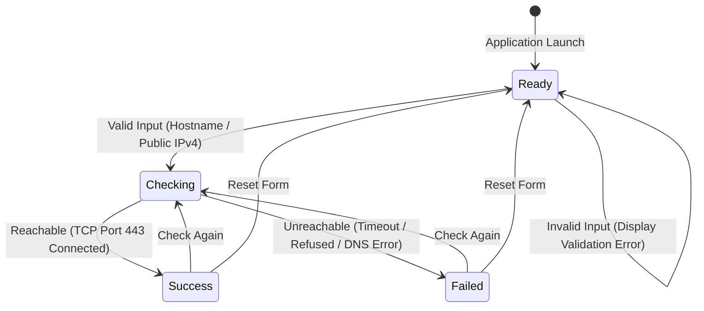

# Finite State Machine (FSM) State Diagram

## 1. Introduction and Automata Theory Definition

The **Network Connection Checker** lifecycle is governed by a Deterministic Finite Automaton (DFA) / Finite State Machine (FSM) under Formal Languages and Automata Theory (FLAT).

The machine is formally defined as a 5-tuple:

$$M = (Q, \Sigma, \delta, q_0, F)$$

Where:
- **$Q$** (Finite set of states): $\{\text{Ready}, \text{Checking}, \text{Success}, \text{Failed}\}$
- **$\Sigma$** (Alphabet / Input events): $\{\text{Valid Input}, \text{Invalid Input}, \text{Reachable}, \text{Unreachable}, \text{Check Again}, \text{Reset}\}$
- **$q_0$** (Initial state): $\text{Ready}$
- **$F$** (Terminal / Operating states): $\{\text{Success}, \text{Failed}\}$
- **$\delta$** (State transition function): $Q \times \Sigma \to Q$

---

## 2. Mermaid State Transition Diagram

---

## 3. Explanation of States

| State | Name | Description |
|---|---|---|
| **$q_0$** | **Ready** | The initial idle state. The application displays an empty input field and is waiting for the user to submit a hostname or IPv4 address. |
| **$q_1$** | **Checking** | The active processing state. The application is querying DNS and attempting a TCP handshake on port 443 with a 5000ms timeout. A loading spinner is displayed to the user. |
| **$q_2$** | **Success** | A terminal state indicating network reachability. The server responded on port 443. The interface highlights the result in green and shows the measured round-trip time in milliseconds. |
| **$q_3$** | **Failed** | A terminal state indicating network failure. The connection timed out, was actively refused, or DNS resolution failed. The interface highlights the result in red and displays an explanatory error message. |

---

## 4. Explanation of Transitions

1. **Ready + Valid Input $\to$ Checking**
   - **Trigger**: The user inputs a syntactically valid public hostname (e.g., `google.com`) or public IPv4 address (e.g., `1.1.1.1`) and clicks *Check Connection*.
   - **Action**: UI enters loading state; initiates `POST /api/check`.

2. **Ready + Invalid Input $\to$ Ready**
   - **Trigger**: The user inputs an empty string, invalid characters, localhost, loopback, or private IP addresses (e.g., `127.0.0.1`, `192.168.1.1`).
   - **Action**: Transition loopback on `Ready`. The application immediately displays an inline validation error and halts network execution.

3. **Checking + Reachable $\to$ Success**
   - **Trigger**: Backend establishes a successful TCP connection on port 443 within the 5-second timeout window.
   - **Action**: Result is logged to MongoDB; UI transitions to `Success` state displaying response time in green.

4. **Checking + Unreachable $\to$ Failed**
   - **Trigger**: The TCP connection times out (> 5000ms), DNS fails (`ENOTFOUND`), or the port connection is refused.
   - **Action**: Failure record is saved to MongoDB; UI transitions to `Failed` state displaying error details in red.

5. **Success + Check Again $\to$ Checking**
   - **Trigger**: User modifies the input or clicks *Check Connection* from the `Success` state.
   - **Action**: Re-evaluates target and begins a new connection check.

6. **Failed + Check Again $\to$ Checking**
   - **Trigger**: User clicks *Check Connection* again or tests another host from the `Failed` state.
   - **Action**: Re-initiates verification pipeline.

7. **Success / Failed + Reset $\to$ Ready**
   - **Trigger**: User clicks the *Reset* button.
   - **Action**: Clears active results, resets form inputs, and returns interface to the initial `Ready` state.
