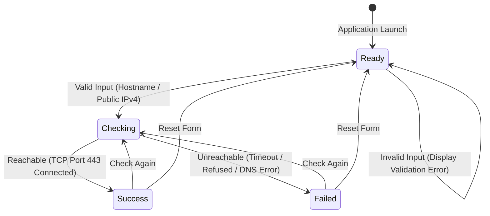

# Network Connection Checker

A full-stack **MERN** web application that allows users to verify whether a server or website is reachable over the network by entering its domain hostname or IPv4 address. The project models the entire verification lifecycle using a **Deterministic Finite State Machine (FSM)** from **Formal Languages and Automata Theory (FLAT)**.

---

## Table of Contents

1. [Project Overview](#1-project-overview)
2. [Objectives](#2-objectives)
3. [Technologies Used](#3-technologies-used)
4. [Key Features](#4-key-features)
5. [Automata Theory & FSM Implementation](#5-automata-theory--fsm-implementation)
   - [Formal 5-Tuple Definition](#formal-5-tuple-definition)
   - [Mermaid State Diagram](#mermaid-state-diagram)
   - [Transition Table](#transition-table)
6. [Folder Structure](#6-folder-structure)
7. [Installation & Setup](#7-installation--setup)
   - [Prerequisites](#prerequisites)
   - [1. Backend Setup](#1-backend-setup)
   - [2. Frontend Setup](#2-frontend-setup)
8. [Running the Application Locally](#8-running-the-application-locally)
9. [MongoDB Configuration](#9-mongodb-configuration)
10. [Deploying on Render as a Single Website](#10-deploying-on-render-as-a-single-website)
11. [API Documentation](#11-api-documentation)
    - [POST /api/check](#post-apicheck)
    - [GET /api/history](#get-apihistory)
    - [DELETE /api/history](#delete-apihistory)
12. [Sample Input & Output](#12-sample-input--output)
13. [Validation & Security Restrictions](#13-validation--security-restrictions)
14. [Screenshots & UI Walkthrough](#14-screenshots--ui-walkthrough)
15. [Testing Suite](#15-testing-suite)

---

## 1. Project Overview

The **Network Connection Checker** provides a web interface where a user can input any public domain name (e.g., `google.com`) or public IPv4 address (e.g., `1.1.1.1`). The Node.js Express backend validates the target, resolves the domain through DNS, and performs a single TCP connection handshake strictly on **port 443** within a 5-second timeout window. The measured round-trip response time (in milliseconds) and status are returned to the client and automatically logged to MongoDB.

---

## 2. Objectives

- Allow users to test reachability of remote servers and websites.
- Provide clear visual indicators for **Success** (Green) and **Failed** (Red).
- Accurately measure TCP connection latency (response time in ms).
- Strictly enforce security policies: prevent SSRF, port scanning, arbitrary port abuse, and non-public IP probing.
- Persist connection test history in a MongoDB database with filtering and deletion capabilities.
- Implement and demonstrate a **Finite State Machine (FSM)** according to Formal Languages and Automata Theory.

---

## 3. Technologies Used

- **Frontend**: React.js (v18) bootstrapped with Vite
- **Backend**: Node.js (v20+) runtime environment
- **API Framework**: Express.js
- **Database**: MongoDB with Mongoose ODM
- **Styling**: Pure semantic HTML5 & Vanilla CSS3 (responsive, professional design)
- **Programming Language**: Modern JavaScript (ES6+ / CommonJS for backend, ES Modules for frontend)

---

## 4. Key Features

- **Live Reachability Check**: Measures response time on TCP port 443.
- **Automata State Visualization**: Real-time badge in the UI displaying the active FSM state (`Ready`, `Checking`, `Success`, `Failed`).
- **Comprehensive History Log**: Stored in MongoDB, ordered newest first.
- **Filter History**: Filter records by status (*All*, *Success*, *Failed*).
- **Clear History**: Delete previous history with a user confirmation prompt.
- **Quick Test Presets**: One-click preset buttons for rapid demonstration (`google.com`, `github.com`, `1.1.1.1`, `localhost`, `192.168.1.1`).
- **Security-First Architecture**: Strictly rejects loopback (`127.0.0.1`), `localhost`, private subnets (RFC 1918), link-local (`169.254.0.0/16`), multicast, and reserved addresses before socket creation.
- **Unified Single-Website Deployment**: The Express server serves both the React UI and API endpoints simultaneously.

---

## 5. Automata Theory & FSM Implementation

The core verification workflow is modeled as a Deterministic Finite Automaton (DFA) in `frontend/src/fsm/connectionFSM.js`.

### Formal 5-Tuple Definition

$$M = (Q, \Sigma, \delta, q_0, F)$$

- **$Q$ (States)**:
  - `Ready`: Initial state awaiting user input.
  - `Checking`: Verification in progress (TCP socket handshake pending).
  - `Success`: Target server reachable on port 443.
  - `Failed`: Target unreachable, timed out, or DNS failed.
- **$\Sigma$ (Alphabet / Events)**:
  - `SUBMIT_VALID`: User submits valid hostname/IP.
  - `SUBMIT_INVALID`: Input is empty, invalid format, or private IP.
  - `REACHABLE`: TCP connection established on port 443.
  - `UNREACHABLE`: Connection timed out, refused, or DNS failed.
  - `CHECK_AGAIN`: User re-tests from Success or Failed state.
  - `RESET`: User clears results back to initial state.
- **$q_0$ (Initial State)**: `Ready`
- **$F$ (Accepting / Operational States)**: `{ Success, Failed }`
- **$\delta$ (Transition Function)**: $Q \times \Sigma \to Q$

### Mermaid State Diagram



### Transition Table

| Current State ($q$) | Input Event ($\sigma$) | Next State ($\delta(q, \sigma)$) | Description |
|---|---|---|---|
| **Ready** | `SUBMIT_VALID` | **Checking** | Transitions to checking state; initiates network test. |
| **Ready** | `SUBMIT_INVALID` | **Ready** | Displays validation error inline; stays in Ready. |
| **Checking** | `REACHABLE` | **Success** | TCP handshake succeeded on port 443; displays latency in green. |
| **Checking** | `UNREACHABLE` | **Failed** | Connection timed out or failed; displays error in red. |
| **Success** | `CHECK_AGAIN` | **Checking** | Starts a new connection test. |
| **Success** | `RESET` | **Ready** | Clears inputs and returns to idle state. |
| **Failed** | `CHECK_AGAIN` | **Checking** | Starts a new connection test. |
| **Failed** | `RESET` | **Ready** | Clears inputs and returns to idle state. |

---

## 6. Folder Structure

```
NetworkConnectionChecker/
├── backend/
│   ├── models/
│   │   └── Connection.js       # Mongoose model schema
│   ├── routes/
│   │   └── connectionRoutes.js # Express router (/api/check, /api/history)
│   ├── utils/
│   │   └── networkChecker.js   # DNS resolution, IPv4 validation, TCP check
│   ├── test-suite.js           # Automated end-to-end backend tests
│   ├── server.js               # Express server entry point (serves API & static UI)
│   ├── .env                    # Local environment config
│   ├── .env.example            # Sample configuration template
│   └── package.json            # Backend dependencies
├── frontend/
│   ├── src/
│   │   ├── fsm/
│   │   │   ├── connectionFSM.js      # Automata FSM state machine implementation
│   │   │   └── connectionFSM.test.js # FSM formal unit verification
│   │   ├── App.jsx             # Main React application component
│   │   ├── App.css             # Component styling
│   │   ├── index.css           # Global reset and typography
│   │   └── main.jsx            # React root mount
│   ├── index.html              # HTML entry template
│   ├── vite.config.js          # Vite configuration and backend API proxy
│   └── package.json            # Frontend dependencies
├── FLAT/
│   ├── state-diagram.md        # Mermaid state diagram and theoretical details
│   └── transition-table.md     # Mathematical transition table and matrix
├── render.yaml                 # Render Blueprint for 1-click single-website deploy
├── .gitignore                  # Git ignore rules for node_modules and .env
├── package.json                # Root workspace scripts (build & start)
└── README.md                   # Complete documentation
```

---

## 7. Installation & Setup

### Prerequisites

- **Node.js** (v18.0.0 or higher)
- **npm** (v9.0.0 or higher)
- **MongoDB** running locally on port 27017 or a MongoDB Atlas URI

### 1. Backend Setup

```bash
cd backend
npm install
```

### 2. Frontend Setup

```bash
cd frontend
npm install
```

---

## 8. Running the Application Locally

### Option A: Unified Single-Port Mode (Same as Render Production)
```bash
# From root directory:
npm run build
npm start
```
Open **`http://localhost:5000`** in your browser. Both the React UI and Express API are served on port 5000!

### Option B: Separate Development Mode
- **Terminal 1**: `npm run dev:backend` (Backend on `http://localhost:5000`)
- **Terminal 2**: `npm run dev:frontend` (Vite dev server on `http://localhost:3000`)

---

## 9. MongoDB Configuration

The application connects to MongoDB using Mongoose. The database stores all completed reachability checks in the `connections` collection.

Each record conforms to the following schema:
```javascript
{
  hostname: String,     // e.g. "google.com" or "1.1.1.1"
  status: String,       // 'Success' | 'Failed'
  message: String,      // Human-readable status description
  responseTime: Number, // Measured latency in ms (null if unreachable)
  checkedAt: Date       // Timestamp of check (default: Date.now)
}
```

---

## 10. Deploying on Render as a Single Website

The project is structured so Render runs both the backend and serves the frontend from a single Web Service on Render's **Free Plan**.

### Step 1: Sign in to Render
1. Go to [https://render.com](https://render.com) and log in with your GitHub account (`deekshikhaarun0604`).

### Step 2: Create a New Web Service
1. Click **"New +"** in the top right, then select **"Web Service"**.
2. Select your repository: **`deekshikhaarun0604/network-connection-checker`**.
3. Fill in the service configuration:
   - **Name**: `network-connection-checker`
   - **Region**: Choose the closest region (e.g., *Oregon (US West)* or *Frankfurt*)
   - **Branch**: `main`
   - **Root Directory**: *(leave blank to use root)*
   - **Runtime**: `Node`
   - **Build Command**: `npm run build`
   - **Start Command**: `npm start`
   - **Instance Type**: **Free** ($0/month)

### Step 3: Add Environment Variables
Under the **Environment Variables** section:
- **`NODE_ENV`**: `production`
- **`MONGO_URI`**: Your MongoDB connection string (e.g., from MongoDB Atlas: `mongodb+srv://<username>:<password>@cluster0.mongodb.net/networkChecker?retryWrites=true&w=majority`)

### Step 4: Deploy
Click **"Create Web Service"**.  
Render will run `npm run build` (which installs all packages and compiles the React app), then start the server with `npm start`.

Once deployed, Render gives you a public URL such as:  
**`https://network-connection-checker.onrender.com`**

---

## 11. API Documentation

### POST `/api/check`
Initiates a reachability check for a domain or public IPv4 address on TCP port 443.

- **Request Body**:
  ```json
  {
    "hostname": "google.com"
  }
  ```
- **Response (200 OK - Reachable)**:
  ```json
  {
    "_id": "672b1234abcd5678ef901234",
    "hostname": "google.com",
    "status": "Success",
    "responseTime": 42,
    "message": "Successfully reached google.com (142.250.190.46) on port 443.",
    "checkedAt": "2026-11-06T15:30:00.000Z"
  }
  ```
- **Response (200 OK - Unreachable / Timeout / DNS Failure)**:
  ```json
  {
    "_id": "672b1234abcd5678ef905678",
    "hostname": "nonexistent-domain-test.xyz",
    "status": "Failed",
    "responseTime": null,
    "message": "DNS resolution failed: Unable to resolve domain 'nonexistent-domain-test.xyz' (ENOTFOUND).",
    "checkedAt": "2026-11-06T15:31:00.000Z"
  }
  ```
- **Response (400 Bad Request - Security Rejection or Invalid Input)**:
  ```json
  {
    "status": "Failed",
    "hostname": "localhost",
    "message": "Access denied: Localhost and private domain names are restricted."
  }
  ```

### GET `/api/history`
Retrieves past connection checks from MongoDB, sorted newest first.

### DELETE `/api/history`
Clears all saved connection check history from MongoDB.

---

## 12. Sample Input & Output

| Test Input | Input Category | Expected FSM State | Result Status | Result Details |
|---|---|---|---|---|
| `google.com` | Public Domain | `Success` | **Success** (Green) | ~30-60 ms response time |
| `github.com` | Public Domain | `Success` | **Success** (Green) | ~40-70 ms response time |
| `1.1.1.1` | Public IPv4 (Cloudflare) | `Success` | **Success** (Green) | ~25-50 ms response time |
| `localhost` | Loopback Hostname | `Ready` (Validation Error) | **Blocked** | "Access denied: Localhost is restricted." |
| `127.0.0.1` | Loopback IP | `Ready` (Validation Error) | **Blocked** | "Access denied: Loopback address is restricted." |
| `192.168.1.1` | Private IPv4 (RFC 1918) | `Ready` (Validation Error) | **Blocked** | "Access denied: Private network address is restricted." |
| `999.999.999.999` | Malformed IP | `Ready` (Validation Error) | **Blocked** | "Malformed IPv4 address." |
| `invalid-domain-xyz-404.org` | Nonexistent Domain | `Failed` | **Failed** (Red) | "DNS resolution failed (ENOTFOUND)." |

---

## 13. Validation & Security Restrictions

1. **Port Restriction**: Only connects to **port 443** (HTTPS standard TCP port).
2. **No Port Scanning / IP Range Scanning**: Only one target hostname or IPv4 address is inspected per request.
3. **No Private / Internal Probing**:
   - Loopback: `127.0.0.0/8`
   - RFC 1918 Private Ranges: `10.0.0.0/8`, `172.16.0.0/12`, `192.168.0.0/16`
   - Link-Local: `169.254.0.0/16`
   - CGNAT: `100.64.0.0/10`
   - Multicast: `224.0.0.0/4`
   - Reserved / Broadcast: `240.0.0.0/4`, `255.255.255.255`
4. **DNS Rebinding Prevention**: Resolved IP addresses are re-validated against the private IP filter before any TCP socket connection is initiated.

---

## 14. Screenshots & UI Walkthrough

```
+-----------------------------------------------------------------------+
|                       Network Connection Checker                      |
| Verify whether a website or server is reachable by checking port 443  |
|                       [ Automata State: READY ]                       |
+-----------------------------------------------------------------------+
| Hostname or IPv4 Address:                                             |
| [ google.com                                ] [ Check Connection ]    |
|                                                                       |
| Quick Presets: [google.com] [github.com] [1.1.1.1] [localhost]       |
+-----------------------------------------------------------------------+
| [✓ Success] Target: google.com                                        |
| Status: Success                                                       |
| Response Time: 30 ms                                                  |
| Details: Successfully reached google.com (142.250.190.46) on port 443 |
+-----------------------------------------------------------------------+
| Connection History                         Filter: [ All v ] [Clear]  |
| +---------+------------+---------------+----------------------------+ |
| | Status  | Hostname   | Response Time | Checked At                 | |
| +---------+------------+---------------+----------------------------+ |
| | SUCCESS | google.com | 30 ms         | 06/11/2026, 9:05 PM        | |
| +---------+------------+---------------+----------------------------+ |
```

---

## 15. Testing Suite

The project includes two built-in automated test suites:

### 1. FSM Automata Unit Tests
```bash
node frontend/src/fsm/connectionFSM.test.js
```
*Output: `FSM TEST SUMMARY: 9 Passed, 0 Failed`*

### 2. End-to-End Backend & Network Tests
```bash
node backend/test-suite.js
```
*Output: `TEST SUMMARY: 17 Passed, 0 Failed`*
